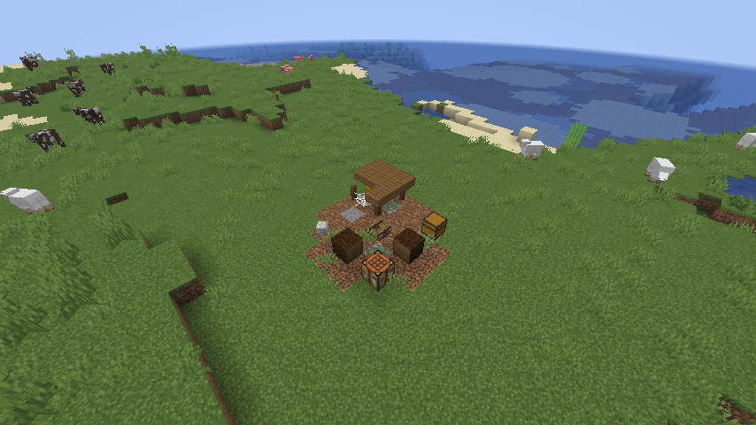
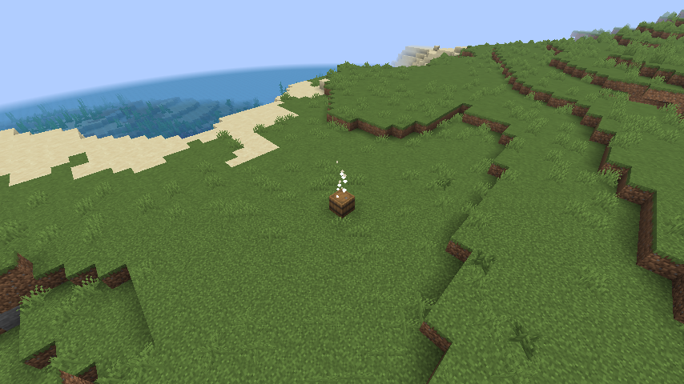

# Wildfront

A Minecraft Java Edition mod (Fabric) about dynamic exploration: rare world events, mysterious
discoveries and abandoned places that make the world feel unpredictable and alive, without
replacing vanilla survival.

**Version 0.1.1** for Minecraft 26.3 (Fabric). It adds:

- **Mysterious Discovery**, a dynamic event: a forgotten cache appears near a player who is out
  exploring, the player is told which way to look, and whoever opens it is rewarded.
- **Abandoned camps**, a small structure with supplies left behind, in newly generated terrain.
- A configurable, server-side event system both are built on.

| Abandoned camp | Forgotten cache |
|----------------|-----------------|
|  |  |

See [CHANGELOG.md](CHANGELOG.md) for the full list of features and known limitations.

## Installing

1. Install [Fabric Loader](https://fabricmc.net/use/) 0.19.5 or newer for Minecraft 26.3.
2. Download `wildfront-0.1.1+mc26.3.jar` from the
   [latest release](https://github.com/lipereis/wildfront/releases/latest) (not the `-sources` file).
3. Put it and [Fabric API](https://modrinth.com/mod/fabric-api) in the `mods` folder of the game
   directory that your Fabric installation uses.

All gameplay runs on the server. In multiplayer the mod is only required on the server; players
without it see the English texts. Java 25 is required, as for Minecraft 26.3 itself.

## Versions

| Component     | Version       |
|---------------|---------------|
| Minecraft     | 26.3          |
| Fabric Loader | 0.19.5        |
| Fabric API    | 0.162.0+26.3  |
| Fabric Loom   | 1.18.4        |
| Gradle        | 9.7.1 (wrapper) |
| Java          | JDK 25        |

Versions live in [gradle.properties](gradle.properties).

## Setup

1. Install JDK 25:

   ```
   winget install EclipseAdoptium.Temurin.25.JDK
   ```

2. Make sure `JAVA_HOME` points at the JDK 25 install directory and open a new terminal.
   `java -version` must report 25.
3. Gradle does not need to be installed; the wrapper (`gradlew.bat`) downloads it.

The first build downloads Gradle, Minecraft and all dependencies, which takes several minutes.

## Build

```
.\gradlew.bat build
```

Runs the unit tests and the headless in-world game tests, and writes the release jar to
`build/libs/wildfront-<version>.jar` (plus a `-sources` jar). The version is set in
[gradle.properties](gradle.properties).

## Tests

| Command | What it runs | Part of `build` |
|---------|--------------|-----------------|
| `.\gradlew.bat test` | Unit tests for logic that needs no world: scheduling, cooldowns, config validation, directions | yes |
| `.\gradlew.bat runGameTest` | Game tests on a headless server: caches, loot, expiry, site selection, the automatic event check with several players, commands, camp data and generation, and a timing check of the timer-driven code. Ends with `All N required tests passed` | yes |
| `.\gradlew.bat runClientGameTest` | Opens a real game window, creates a normally generated world, finds a naturally generated camp, triggers the event by command and waits for it to trigger on its own. Writes screenshots to `build/run/clientGameTest/screenshots` | no |
| `.\gradlew.bat runClientGameTest "-Pwildfront.acceptMinecraftEula=true"` | The same, followed by a dedicated-server test: starts a real dedicated server on localhost, connects the client to it and checks command permissions, a forced and an automatic event, finding and expiry of a cache, and a naturally generated camp. Without the flag this part reports `SKIPPED` | no |
| `.\gradlew.bat runProductionClient` | Starts a non-development client with the release jar, as a player would run it. Close the window to end it | no |

Starting a dedicated server requires accepting the [Minecraft EULA](https://aka.ms/MinecraftEULA).
Passing `-Pwildfront.acceptMinecraftEula=true` is how you state that you accept it; it is never
accepted by default and CI does not run this test.

### Performance

All gameplay code runs on the server thread and is driven by two timers; nothing scans blocks or
loads chunks on a timer.

- **Every tick:** two remainder checks and one config read.
- **Every `checkIntervalSeconds` (default 10 s):** one check per online player. Measured by the
  game test `timerDrivenCodeIsCheap` on the development machine: about 0.15 microseconds for a
  player on cooldown (the usual case) and about 0.85 microseconds when every condition is
  evaluated. A trigger additionally does at most 12 heightmap lookups in loaded chunks.
- **Every 2 seconds, only while caches exist:** one block entity lookup, one particle packet and
  sometimes one sound per cache in a loaded chunk; about 1.5 microseconds per cache measured.

For comparison, a server tick has a budget of 50,000 microseconds.

## Development client

```
.\gradlew.bat runClient
```

Starts Minecraft 26.3 with Wildfront loaded. The game directory is `run/`.
To confirm the mod loaded, look for these lines in the console or in `run/logs/latest.log`:

```
[Wildfront] Registered 1 event(s): [mysterious_discovery]
[Wildfront] Initialized (version 0.1.1+mc26.3, environment CLIENT)
[Wildfront] Client initialized
```

A dedicated development server is available with `.\gradlew.bat runServer`
(accept the EULA in `run/eula.txt` on first start).

## Configuration

`config/wildfront.json` (in the dev environment: `run/config/wildfront.json`) is created on first
start. Apply edits with `/wildfront reload` or by restarting.

```json
{
  "eventsEnabled": true,
  "checkIntervalSeconds": 10,
  "globalCooldownSeconds": 120,
  "shareRadius": 48,
  "events": {
    "mysterious_discovery": {
      "enabled": true,
      "cooldownSeconds": 600,
      "triggerChance": 0.05,
      "minDistanceFromSpawn": 128,
      "timeOfDay": "any",
      "weather": "any"
    }
  },
  "discovery": {
    "minDistance": 24,
    "maxDistance": 48,
    "lifetimeSeconds": 600,
    "maxActive": 8
  }
}
```

General settings:

| Key | Default | Range | Meaning |
|-----|---------|-------|---------|
| `eventsEnabled` | `true` | | Master switch for automatic events |
| `checkIntervalSeconds` | `10` | 1 – 3600 | How often online players are checked |
| `globalCooldownSeconds` | `120` | 0 – 604800 | Minimum time between any two events for the same player |
| `shareRadius` | `48` | 0 – 512 | Players this close to a triggering player witness the same event instead of getting their own; 0 disables sharing |

Settings of each event under `events.<event id>` (defaults differ per event; the ones shown are
for `mysterious_discovery`):

| Key | Default | Allowed | Meaning |
|-----|---------|---------|---------|
| `enabled` | `true` | | Whether the event triggers on its own |
| `cooldownSeconds` | `600` | 0 – 604800 | Minimum time between two triggers of this event for the same player |
| `triggerChance` | `0.05` | 0 – 1 | Chance per check, once all cooldowns are over, that the event triggers |
| `minDistanceFromSpawn` | `128` | 0 – 1000000 | Horizontal distance in blocks from world spawn required; 0 for none |
| `timeOfDay` | `"any"` | `any`, `day`, `night` | Night is 13000 – 23000 on the day clock |
| `weather` | `"any"` | `any`, `clear`, `rain`, `thunder` | `rain` includes thunderstorms; biomes without rain are not considered |

Settings of the forgotten cache under `discovery`:

| Key | Default | Range | Meaning |
|-----|---------|-------|---------|
| `minDistance` | `24` | 8 – 128 | Closest the cache appears to the triggering player, in blocks |
| `maxDistance` | `48` | 8 – 128 | Furthest the cache appears; must not be smaller than `minDistance` |
| `lifetimeSeconds` | `600` | 30 – 86400 | How long an unopened cache stays before it is removed |
| `maxActive` | `8` | 1 – 64 | How many caches may be waiting to be found at once on the server |

A missing, mistyped or out-of-range value is replaced by its default and reported in the log and by
`/wildfront reload`. A file that is not valid JSON is left untouched and defaults are used for
everything. Config files from Milestone 2 used a `mysteriousDiscovery` section; it is no longer
read and must be moved to `events.mysterious_discovery`.

### How triggering works

Every `checkIntervalSeconds` the server looks at each living player in survival or adventure mode.
For such a player an event triggers when, in this order: the event is enabled, the player's global
cooldown is over, the event's own cooldown is over, the chance roll succeeds, and the configured
conditions (distance, time of day, weather) plus the event's own requirements hold. Mysterious
Discovery additionally requires the overworld.

One occurrence is shared: eligible players within `shareRadius` blocks of the triggering player
receive the same event and start the same cooldowns, so a group travelling together gets one event,
not one each. At most one event triggers per player per check. Cooldowns are stored per player and
survive death, relogging and restarts. If an event cannot happen where the player is (for example
no suitable place nearby), no cooldown starts and it is tried again on a later check.

### Mysterious Discovery

1. A forgotten cache (a barrel) appears on the surface `minDistance` to `maxDistance` blocks from
   the player. It only ever replaces air or plants, stands on solid ground, never in water or
   lava, is at most 24 blocks above or below the player, and only loaded chunks are considered.
2. Every participant gets a chat message naming the direction, for example
   *"You sense that something unusual has appeared to the north-east..."*.
3. Up close the cache is marked by a column of white particles (visible within about 32 blocks)
   and a soft chime every 6 seconds.
4. Opening the cache generates its loot: a few stacks of supplies (iron, gold, emeralds, bread,
   arrows, experience bottles, ender pearls) and one valuable (diamonds, an enchanted book, a name
   tag, a saddle, a spyglass or a golden apple). The barrel stays and belongs to the player.
5. A cache nobody opened is removed after `lifetimeSeconds` without dropping anything. Breaking an
   unopened cache drops its loot, as with any loot container.

The loot is defined in `data/wildfront/loot_table/discovery/forgotten_cache.json` and can be
replaced by a data pack. Caches are tracked in the world save, so they are still cleaned up after a
restart; a cache in an unloaded chunk is handled when its chunk is loaded again.

## Abandoned camp

A small, long-deserted traveller's camp: a cold fire pit with two log seats, a collapsed lean-to
with a hay bedroll, a crafting table, a skull, and a chest of travel supplies (food, coal, torches,
string, leather, a worn tool or a compass or map, sometimes emeralds, gold, a saddle or an enchanted
book).

- Generates on the surface in forests, taigas, savannas, plains, sunflower plains, meadows and
  snowy plains. Candidate spots are about 380 blocks apart in those biomes (spacing 24 chunks,
  separation 10); a camp only appears at a candidate where the ground is dry and roughly level,
  so hilly or watery regions have fewer.
- **Only in chunks generated after the mod was added.** Existing terrain is never changed.
- Find one with `/locate structure wildfront:abandoned_camp`; build one anywhere with
  `/place structure wildfront:abandoned_camp`.
- Its definition is data, so a data pack can change or disable it:

| File under `data/wildfront/` | Controls |
|------------------------------|----------|
| `worldgen/structure_set/abandoned_camps.json` | How far apart candidate spots are |
| `tags/worldgen/biome/has_structure/abandoned_camp.json` | Which biomes; an empty `values` list with `"replace": true` disables camps |
| `worldgen/structure/abandoned_camp.json` | Height, terrain adaptation, and how level the ground must be |
| `structure/abandoned_camp/camp.nbt` | The blocks |
| `loot_table/structure/abandoned_camp.json` | The chest's loot |

The camp uses the structure type `wildfront:flat_ground_jigsaw`, which the mod adds. It accepts
every setting of `minecraft:jigsaw` plus two of its own:

| Setting | Camp | Meaning |
|---------|------|---------|
| `check_radius` | `7` | Half the side of the square around the structure's start whose terrain is sampled, at nine points |
| `max_height_difference` | `3` | Largest allowed difference between the highest and lowest sampled surface |

A spot is also rejected if water stands on the ground at any sampled point. A rejected spot simply
gets no structure; nothing is moved elsewhere. Data packs may use the type for their own structures.

The blocks of a camp are vanilla and stay if the mod is removed. What the game then reports about
the structure it no longer knows has not been tested.

### Editing the camp

`camp.nbt` is binary and is generated by `tools/generate_structures.py` (Python 3, standard
library only), where the layout is written out block by block. Edit the script, then run this from
the project root and commit the regenerated file:

```
python tools/generate_structures.py
```

Template files written for Minecraft before 26.x do not work unchanged: block states are now
stored under `id`/`properties` instead of `Name`/`Properties`, and the old keys are read as air
without any error. The game test `templateBuildsTheCampWithLoot` catches this.

## Commands

All require operator permission (game master level; cheats enabled in singleplayer).

| Command | Effect |
|---------|--------|
| `/wildfront event list` | Shows settings, your remaining cooldowns and which conditions you are still waiting for |
| `/wildfront event trigger <event> [player]` | Triggers an event now, ignoring cooldowns, chance and conditions, and starts the cooldowns |
| `/wildfront event reset [player]` | Clears the player's event cooldowns |
| `/wildfront reload` | Reloads the config file and reports problems |

## Testing the event in a world

1. `.\gradlew.bat runClient`, create a **survival** world with **cheats allowed**.
2. `/wildfront event trigger mysterious_discovery` — a purple chat message names a direction and
   the log shows `Forgotten cache placed at X, Y, Z`. Walk that way: within about 32 blocks a column
   of white particles and a chime mark a barrel. Open it: it contains loot, and the action bar
   shows *You uncovered a forgotten cache.*
3. Expiry: set `"discovery": { "lifetimeSeconds": 30 }` in `run/config/wildfront.json`, run
   `/wildfront reload` and `/wildfront event reset`, trigger again and do not open the cache. After
   30 seconds it disappears with a puff and the log shows `expired unopened and was removed`.
4. To see automatic triggering quickly, replace the content of `run/config/wildfront.json` with
   this and run `/wildfront reload`:

   ```json
   {
     "checkIntervalSeconds": 1,
     "globalCooldownSeconds": 0,
     "events": {
       "mysterious_discovery": { "cooldownSeconds": 15, "triggerChance": 1, "minDistanceFromSpawn": 0 }
     },
     "discovery": { "lifetimeSeconds": 30 }
   }
   ```

   A cache then appears every 15 seconds. `/wildfront event list` shows the countdown.
5. Conditions: add `"timeOfDay": "night"` to the event, reload, then `/time set day` (no triggers,
   list shows `waiting for: time of day NIGHT`) and `/time set night` (triggers resume). The same
   works with `"weather": "thunder"` and `/weather thunder`.
6. Global cooldown: set `"globalCooldownSeconds": 40` and reload; triggers are now 40 seconds apart
   although the event cooldown is 15.
7. Restore the defaults afterwards (delete the file and run `/wildfront reload`).

## Testing the abandoned camp in a world

1. Create a **new** world (camps only generate in new chunks) with cheats allowed.
2. `/locate structure wildfront:abandoned_camp`, click the coordinates in chat to teleport, and
   look at how the camp sits in the terrain.
3. Open the chest: it contains travel supplies.
4. `/place structure wildfront:abandoned_camp` builds another one where you stand.

## Project layout

```
src/main/java/dev/wildfront/
  Wildfront.java       mod entrypoint
  event/               WorldEvent (definition), EventScheduler (rules), EventManager (server hook)
  event/trigger/       configurable trigger conditions (distance, time of day, weather)
  event/type/          concrete events
  discovery/           forgotten cache: site selection, placement, tracking, expiry
  registry/            central registration of events, data attachments, loot table keys and structure types
  worldgen/            structure type that only generates on dry, level ground
  config/              config file loading and validation
  command/             /wildfront commands
src/main/resources/    fabric.mod.json, assets, and data (loot tables, world generation, structure templates)
src/client/java/dev/wildfront/client   client-only code
src/test/java/         JUnit tests
src/gametest/java/     in-world game tests, run on a headless server
tools/                 generators for the binary structure template and the icon
docs/images/           screenshots taken by the client game test
.github/workflows/     CI: build and tests on every push
```

## Releasing

1. Set `version` in [gradle.properties](gradle.properties) and add a section headed
   `## <version without +mc...>` to [CHANGELOG.md](CHANGELOG.md).
2. `.\gradlew.bat clean build` — unit and game tests must pass.
3. `.\gradlew.bat runClientGameTest` — must pass; look at the screenshots.
4. `.\gradlew.bat runProductionClient` — the log must show `[Wildfront] Initialized`; create a world
   and try `/wildfront event trigger mysterious_discovery` and `/locate structure wildfront:abandoned_camp`.
5. Commit, push and wait for the build workflow to pass. Then tag and push the tag:

   ```
   git tag v0.1.1
   git push origin v0.1.1
   ```

   The release workflow builds the tagged commit, runs the tests, and publishes a GitHub release
   with the jar and that version's changelog section. It refuses a tag that does not match
   `version`.

## License

MIT, see [LICENSE](LICENSE).
